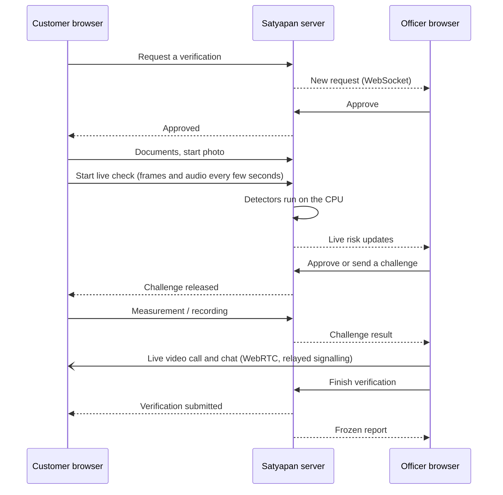

# Satyapan (सत्यापन)

**A live video-KYC (V-CIP) co-pilot that helps a bank officer spot deepfakes and identity fraud during a verification call.**

Team RVSHH · IIT Delhi × Amazon "Raksham AI II" hackathon

Satyapan checks a customer's KYC **documents** first, then gathers independent evidence about the live **voice, video, face,
eyes, camera and network** while an **officer** watches, talks to the customer and releases liveness challenges. Every
recommendation comes with plain-language reasons. Satyapan is decision support: **a person makes every decision**, and the
customer is never shown a risk score or a challenge result, so there is nothing to tune an attack against.

---

## Contents

- [Features](#features)
- [How a verification works](#how-a-verification-works)
- [Tech stack](#tech-stack)
- [Project structure](#project-structure)
- [Getting started](#getting-started)
- [Models (one-time setup)](#models-one-time-setup)
- [Configuration](#configuration)
- [Using another device on your network (HTTPS)](#using-another-device-on-your-network-https)
- [Testing](#testing)
- [Developer model test lab](#developer-model-test-lab)
- [Troubleshooting](#troubleshooting)
- [Honest limits](#honest-limits)
- [Further documentation](#further-documentation)

---

## Features

**For the customer**
- Requests a verification, then waits for an officer to approve it.
- Uploads KYC documents (PAN, Aadhaar and others), which are checked for format, checksum and consistency before the camera starts.
- Takes a start photo, then completes a live check with challenges: head turns, blinks, saying three words aloud, and a close-up eye scan.
- Can chat with the officer and accept a live video call.

**For the officer**
- A review console with live sessions, pending requests and an approval queue.
- A live workspace showing the customer's **video and audio** (WebRTC, peer to peer, not recorded), with **chat**.
- Challenge control: approve or regenerate each generated challenge, auto-release, or **send a challenge of their choice**.
- Evidence families shown as colours (GREEN / AMBER / RED / GREY), each with the reasons behind it.
- **Finish verification** to complete the session, or **End session now** to stop it at once. Either way the report is frozen.
- A downloadable report (PDF, HTML, JSON) and a hash-chained evidence log.

**Evidence families**

| Family | Source | Notes |
|---|---|---|
| Voice authenticity | fine-tuned wav2vec2 anti-spoof model | judged over **all** clips in the session |
| Face video authenticity | ViT deepfake classifier | over all frames, the worst quarter and the latest window |
| Lip sync | SyncNet | supporting only; research-only weights |
| Face = start photo | OpenCV YuNet + SFace | 88-100 % of genuine pairs accepted, under 0.5 % of impostors on real-photo tests; drift tracked |
| Iris = start photo | MediaPipe iris landmarks + classical iris code | webcam-size irises are inconclusive by design (see docs); never RED on its own |
| Liveness (challenges) | browser measurement **cross-checked on the server's own frames** | a contradicted browser claim is a tampering indicator |
| Spoken words | **Whisper speech-to-text on the server** | the recording is transcribed in memory and not stored |
| Camera is a real device | rule-based probe | virtual cameras, injected `getUserMedia`, automation |
| Network | IP lists, optional reputation API, WebRTC leak, header and IP-change checks | VPN / proxy / Tor / data centre |
| Documents | format, checksum, consistency, face on the document | not a lookup in government systems |
| Session pattern | timing, gaps, drift, media coverage | sessions under 90 s cannot be GREEN |

**Overall colour:** **RED** if any hard family is red or three risk points add up · **AMBER** for any concern · **GREY** when
nothing was raised but evidence is missing (the report lists exactly what) · **GREEN** only when nothing was raised *and* enough
independent evidence positively confirms authenticity.

## How a verification works



## Tech stack

| Part | Technology |
|---|---|
| Backend | Python 3.12, Django 5, Django REST Framework, Django Channels (WebSockets), Daphne (ASGI) |
| Models | PyTorch (CPU), Hugging Face Transformers, MediaPipe, OpenCV, NumPy/SciPy |
| Frontend | React 18, TypeScript, Vite, Tailwind CSS, MediaPipe Tasks (in the browser) |
| Real time | WebSockets for events, chat and call signalling; WebRTC for officer ↔ customer video |
| Storage | SQLite by default (`DATABASE_URL` for others); optional Redis for several server processes |

## Project structure

```
.
├── backend/                     Django project
│   ├── satyapan/                settings, ASGI entry point, URL routing
│   ├── apps/
│   │   ├── accounts/            sign-in, roles (customer / officer / developer), bearer tokens
│   │   ├── verification/        sessions, approval, finish / terminate, officer dashboard
│   │   ├── challenges/          liveness challenges, officer approval, server speech-to-text
│   │   ├── documents/           KYC document checks
│   │   ├── voice/ visual/ avsync/ biometrics/ pulse/ integrity/ provenance/   evidence detectors
│   │   ├── signals/             detector registry and model loading
│   │   ├── decision_engine/     the policy that turns evidence into a colour and reasons
│   │   ├── evidence/            hash-chained evidence log
│   │   ├── reports/             frozen report, PDF / HTML / JSON export
│   │   ├── realtime/            WebSocket consumers, live-call and chat relay
│   │   └── devlab/              offline model test lab for developers
│   ├── scripts/                 model download, IP lists, model verification, static checks
│   ├── models/                  model files (weights are NOT in Git, see below)
│   ├── tests/                   pytest suite
│   └── .env.example             every setting, with comments
├── frontend/                    React app
│   ├── src/pages/               customer, officer, report and developer pages
│   ├── src/components/          UI kit, officer panels, call and chat panels
│   ├── src/features/            API service layer, live call (WebRTC)
│   ├── src/hooks/ src/utils/    sockets, media capture, in-browser challenge detection
│   └── .env.example             frontend settings
├── e2e/                         two-browser Playwright test of the full flow
├── docs/                        architecture, models and licences
├── start.sh / start.ps1         one-command start (macOS, Linux / Windows)
└── setup-https.sh / .ps1        local HTTPS certificate for testing on other devices
```

## Getting started

### Prerequisites

- **Python 3.12** (3.13 and 3.14 are not supported by the ML packages)
- **Node.js 18+**
- About 5 GB of free disk space for the ML packages and models
- Optional: `ffmpeg` (MP3/M4A in the developer lab), Tesseract (document OCR), Redis

### Quick start

```bash
git clone https://github.com/lakshmanshukla487-web/Satyapan.git satyapan
cd satyapan
./start.sh            # Windows (PowerShell): .\start.ps1
```

The script:
1. creates `backend/.venv` and installs the requirements, including the ML packages (set `SATYAPAN_ML=0` to skip them; the
   model checks then show as unavailable);
2. copies `backend/.env.example` to `backend/.env` and `frontend/.env.example` to `frontend/.env` if they do not exist;
3. runs `python manage.py setup_db` (creates and checks the database) and adds two demo users;
4. starts the backend on port **8000** and the frontend on **http://localhost:5173**.

Demo logins (development only, created by `create_demo_users`; refused in production):

| Role | Username | Password |
|---|---|---|
| Officer | `officer` | `officer-pass-123` |
| Customer | `customer` | `customer-pass-123` |

Use **two browser profiles** (or a normal and a private window): one is the customer, the other the officer.

### Manual start

```bash
# backend
cd backend
python3.12 -m venv .venv && source .venv/bin/activate
pip install -r requirements.txt -r requirements-ml.txt
cp .env.example .env
python manage.py setup_db
python manage.py create_demo_users
daphne -b 0.0.0.0 -p 8000 satyapan.asgi:application

# frontend (another terminal)
cd frontend
cp .env.example .env
npm install
npm run dev
```

On Intel Macs install with `-c constraints-intel-macos.txt` (the start script does this for you).

### Try the whole flow (about 5 minutes)

1. **Customer:** sign in, tick consent, press *Ask an officer to start my verification*.
2. **Officer** (*Review console*): open *Verification requests* and press *Approve*.
3. **Customer:** fill in the documents. A valid test set: PAN `ABCPS1234F`, Aadhaar `2345 6789 0124`, PIN `110001`, mobile
   `9876543210`, the same name and date of birth on every document; any small JPEG, PNG or PDF works as the file.
4. **Customer:** take the start photo (close, face centred, eyes wide open), then *Start camera and begin*.
5. **Officer:** open the session. *Start live call* to see and hear the customer (they must accept), chat, approve each challenge
   or pick one under *Run a challenge now*, and watch the evidence colours.
6. **Officer:** after at least 90 seconds press **Finish verification**. The customer's page closes the camera on its own.
7. **Officer:** open the **report** and download it as PDF or HTML.

Try a mismatch: a different person in front of the camera than in the start photo is flagged by the face match.

### Mock mode (frontend only)

Set `VITE_USE_MOCKS=true` in `frontend/.env`. Everything is simulated and labelled as such; the approval workflow, live call,
chat and officer actions need the real backend.

## Models (one-time setup)

Model weights are **not stored in Git** (they are large and have their own licences). Every enabled model is loaded **once, on
the CPU, when the server starts**; after that requests only run inference. Anything that is missing shows as an evidence gap
(GREY / "unavailable"), never as suspicion and never as a pass.

```bash
cd backend
source .venv/bin/activate
python scripts/download_models.py --all       # video ViT, face detector + recogniser, landmarks, SyncNet, Whisper
python scripts/update_ip_lists.py             # public VPN / Tor / data-centre address lists
python scripts/verify_models.py               # prints what loaded and what did not
```

| Model | How to get it | Where it goes | Licence |
|---|---|---|---|
| Voice anti-spoof (fine-tuned wav2vec2) | copy **your own** `model.safetensors` | `backend/models/audio/` (its `config.json` and `preprocessor_config.json` are in the repo) | yours |
| Video deepfake (ViT) | `--video` | `backend/models/video/` | Apache-2.0 |
| Face detect + recognise (YuNet, SFace) | `--faces` | `backend/models/*.onnx` | MIT / Apache-2.0 |
| Face landmarks (MediaPipe) | `--landmarks` (the browser copy is downloaded by `npm run dev`) | `backend/models/face_landmarker.task` | Apache-2.0 |
| Lip sync (SyncNet) | `--syncnet` | `backend/models/syncnet/` | **research only**: replace or set `ENABLE_SYNCNET=false` before commercial use |
| Speech-to-text (Whisper base, ~290 MB) | `--speech` | `backend/models/speech/` | MIT |

The "say three words" challenge needs the speech model. For better accuracy on accents set
`SPEECH_MODEL_REPO=openai/whisper-small` in `backend/.env` and run `--speech` again (slower on the CPU).

## Configuration

All backend settings live in `backend/.env`; `backend/.env.example` documents every one of them. The most important:

| Setting | Default | Meaning |
|---|---|---|
| `APP_ENV` | `development` | anything else turns on production checks (secret key, HTTPS origins, HSTS) |
| `DJANGO_SECRET_KEY` | none | **required outside development**: 50+ random characters |
| `ALLOWED_HOSTS` | `localhost,127.0.0.1,[::1]` | host names the server answers to |
| `FRONTEND_ORIGIN`, `EXTRA_ORIGINS` | `http://localhost:5173` | browser origins allowed for the API and WebSockets |
| `DATABASE_URL` | `sqlite:///./satyapan.db` | database |
| `REDIS_URL` | empty | set it to run several server processes |
| `REQUIRE_SESSION_APPROVAL`, `REQUIRE_CHALLENGE_APPROVAL` | `true` | officer approval gates |
| `MIN_SESSION_SECONDS` | `90` | shorter sessions cannot be GREEN |
| `ENABLE_LIVE_CALL`, `STUN_URLS`, `TURN_URLS` | on, Google STUN, empty | live call; add a TURN relay for strict firewalls |
| `ENABLE_SPEECH_CHECK`, `SPEECH_MODEL_REPO` | on, `openai/whisper-base` | server speech-to-text for spoken challenges |
| `ENABLE_*` | mostly on | switch individual detectors on or off |

Frontend settings (`frontend/.env`) are public by design (anything prefixed `VITE_` is visible to every visitor): leave
`VITE_API_BASE_URL` and `VITE_WS_BASE_URL` empty to use the Vite proxy, and set `VITE_USE_MOCKS`.

**Never commit `.env` files, databases, certificates or model weights.** The `.gitignore` keeps them out.

## Using another device on your network (HTTPS)

Browsers only allow the camera and microphone on `localhost` or on HTTPS. To use a phone or a second laptop:

1. Install [mkcert](https://github.com/FiloSottile/mkcert) and set your machine's LAN IP in `setup-https.sh` (`LAN_IP=…`).
2. Run `./setup-https.sh` (Windows: `.\setup-https.ps1`). It writes `frontend/certs/` (ignored by Git; the key is private).
3. Restart `./start.sh` and open `https://<your-lan-ip>:5173`.
4. On the other device, install `frontend/certs/rootCA.pem` as a trusted certificate.

In development the backend accepts WebSocket connections from `localhost` and private network addresses automatically, so live
video and chat work when the address changes. In production list every origin in `FRONTEND_ORIGIN` / `EXTRA_ORIGINS` (https only).

## Testing

```bash
cd backend && pip install -r requirements-dev.txt && pytest      # backend test suite
cd backend && python scripts/static_check.py                     # quick static checks, no install needed
cd frontend && npm run typecheck                                 # TypeScript
cd frontend && npm run build                                     # type-check + production build
python e2e/test_live_flow.py                                     # two-browser flow against a running ./start.sh
```

The end-to-end test needs `pip install playwright && python -m playwright install chromium`; see the top of
`e2e/test_live_flow.py` for its settings. Use a development database: it creates and ends sessions.

## Developer model test lab

At `/developer`, developers can evaluate the deepfake detectors on offline images, videos and audio (single files, batches or
authorised local datasets), with per-file results and, when labels are given, accuracy, precision, recall, F1, balanced accuracy,
ROC AUC and the confusion matrix. It never touches customer sessions, signals, evidence or audit records.

Developer accounts cannot self-register and have no default password:

```bash
cd backend
python manage.py create_developer alice            # prompts for the password twice
python manage.py create_developer alice --revoke   # remove the role again
python manage.py devlab_cleanup                    # optional; expired jobs are cleaned up automatically
```

Optional: `DEVLAB_DATASET_DIR=/path/to/datasets` (one sub-folder per dataset, with `real/` and `fake/` folders or a
`labels.csv`). Uploaded test files are kept only while a job needs them, in `backend/devlab_data/` (ignored by Git).

## Troubleshooting

| Problem | Fix |
|---|---|
| Sign-up or any request returns `503 DATABASE_NOT_READY` / HTTP 500 | run `python manage.py setup_db` in `backend/` (the start scripts do this) |
| Chat or live video does not connect | check the backend terminal for refused WebSocket origins; outside development add the page's origin to `EXTRA_ORIGINS` |
| Live call stays on "Connecting" and then fails | the network blocks direct connections: configure a TURN relay (`TURN_URLS`, `TURN_USERNAME`, `TURN_CREDENTIAL`) |
| "Say three words" is always *unavailable* | download the speech model: `python scripts/download_models.py --speech`, then restart |
| Head-turn / blink challenges are *unavailable* | run `npm run setup:assets` in `frontend/` (downloads the browser face model) |
| A detector shows `MODEL_NOT_DOWNLOADED` or `WEIGHTS_INCOMPLETE` | see [Models](#models-one-time-setup); `python scripts/verify_models.py` lists what is missing |
| Camera does not start on another device | use HTTPS, see [Using another device](#using-another-device-on-your-network-https) |
| `pip install` fails on Python 3.13 / 3.14 | use Python 3.12 |

## Honest limits

- **Documents** are checked for format, checksum, freshness and consistency. This is **not** a lookup in UIDAI, NSDL, DigiLocker or
  the passport office. Only masked numbers are stored.
- **The iris scan is not a retina scan**: a webcam cannot see the retina, and a visible-light iris code is far weaker than
  near-infrared hardware. Its thresholds are **not calibrated on real data**.
- **Face match** catches a *different person*, not a face swap that copies the reference person's identity.
- **Camera and IP checks** rely partly on what the browser reports; a determined attacker can fake some of it, and a residential
  proxy or a fresh VPN looks like an ordinary connection.
- **Deepfake scores** are uncalibrated outputs of public or fine-tuned models compared with demo thresholds. They are not
  probabilities of fraud and generalise imperfectly to new generators.
- **Speech-to-text** can mishear accents or noisy rooms; a spoken challenge needs 2 of the 3 words, and the officer also hears the
  customer live.
- **Rate limits** are per process unless `REDIS_URL` is set.
- The hash chain makes later edits to the evidence log *detectable*; it is not legally certified evidence.

## Further documentation

- [docs/ARCHITECTURE.md](docs/ARCHITECTURE.md): components, data flow, security model
- [docs/MODELS_AND_LICENCES.md](docs/MODELS_AND_LICENCES.md): every model, its licence and what its result means
- [frontend/README.md](frontend/README.md): frontend routes, structure and manual test checklist
- `http://127.0.0.1:8000/docs`: interactive API documentation (development only)
